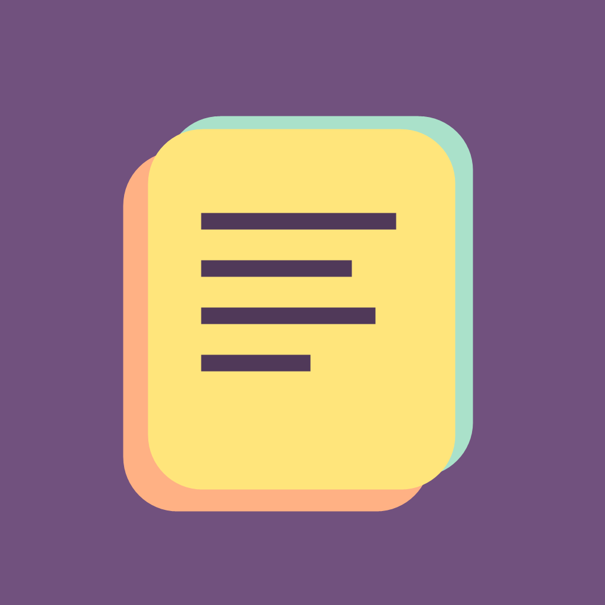

<div align="center">



# BetterNotes

**Colorful sticky notes that stay with you across devices.**

A cross-platform notes app built with Flutter, designed as a richer replacement for Windows Sticky Notes. It works fully offline and can optionally sync through Google sign-in.

[](https://flutter.dev)
[](https://dart.dev)
[](https://supabase.com)
[](#platform-support)
[](LICENSE)

[**Download for Windows**](https://github.com/Azrinfreeman/BetterNotes/releases/latest) · [User guide](docs/USER_GUIDE.md) · [Report a bug](https://github.com/Azrinfreeman/BetterNotes/issues)

</div>

---

## Highlights

- **Desktop sticky notes.** Each note gets its own movable, resizable window on Windows. Windows remember their position, can stay on top, and reopen where you left them.
- **Rich text editing.** Headings, lists, checklists, quotes, inline code, text and highlight colors, font sizes, links, find-in-note, and full undo/redo.
- **Text cleanup.** In a note, choose **More actions > Clean up text...** to preview whitespace cleanup for the selection or whole note. Apply changes when ready; Undo restores the original. Lists, code, headings, and images are protected.
- **Images and ink.** Paste screenshots straight from the clipboard, place images inline, and draw with a mouse, touch, or stylus. Images are compressed automatically.
- **Organize everything.** Titles, tags, favorites, Archive, Trash with undo, saved searches, templates, bulk actions, and several sort orders.
- **Reminders.** Local reminders show Windows notifications and offer Snooze. An optional scheduled task delivers them even when the app is closed.
- **Your data stays yours.** Offline-first local storage, complete ZIP backup and restore, per-note version history, and Markdown and PDF export.
- **Optional cloud sync.** Google sign-in with revision-based sync to Supabase. Row-level security keeps each account's notes private.
- **Migrate from Sticky Notes.** A one-click import copies formatting, colors, dates, and pictures from Windows Sticky Notes.
- **Accessible.** Keyboard shortcuts throughout, high-contrast and large-text support, and reduced-motion handling.

## Tech stack

| Area | Technology |
| --- | --- |
| UI | Flutter, Material 3, [`flutter_quill`](https://pub.dev/packages/flutter_quill) rich-text editor |
| Local storage | [`sembast`](https://pub.dev/packages/sembast) (desktop/mobile) and `sembast_web` (IndexedDB) |
| Cloud | Supabase Auth (Google OAuth), Postgres with row-level security, private Storage bucket |
| Desktop | `desktop_multi_window`, `window_manager`, a native C++ Win32 clipboard bridge, Windows Task Scheduler, and jump lists |
| Export | `pdf`, `archive` (ZIP backups), Markdown |
| Quality | 120+ widget and unit tests, golden tests, `flutter analyze` |

## Architecture

```
lib/
├── main.dart          # App entry, multi-window bootstrap
├── auth/              # Google sign-in and the desktop loopback OAuth callback
├── data/              # Note model, local store, cloud sync, backup/export, image pipeline
├── state/             # Notes controller and editor state
├── desktop/           # Windows integration: windows, tray, auto-start, reminders
├── ui/                # Pages, editor, dialogs, and widgets
└── l10n/              # Localized strings (ARB)
windows/runner/        # Native Win32 code (clipboard, window chrome)
supabase/schema.sql    # Database tables, storage bucket, and RLS policies
test/                  # Unit, widget, and golden tests
```

Notes are always saved locally first. When sync is configured, each note carries a revision number. Edits upload in the background, remote changes arrive through Realtime or polling, and deletions leave tombstones so removed notes don't reappear on other devices.

## Getting started

### Download

Download the portable Windows build from [**Releases**](https://github.com/Azrinfreeman/BetterNotes/releases/latest). Extract the whole archive to a folder and run `better_notes.exe`.

> The executable is not code-signed, so Windows SmartScreen may show a warning on first launch. Choose **More info → Run anyway**.

### Build from source

Prerequisites: the [Flutter SDK](https://docs.flutter.dev/get-started/install). Building for Windows also needs Visual Studio with the "Desktop development with C++" workload and Windows Developer Mode.

```powershell
git clone https://github.com/Azrinfreeman/BetterNotes.git
cd BetterNotes
flutter pub get

flutter run -d windows                 # Windows desktop
flutter run -d chrome --web-port 5173  # Web
```

Without any configuration, the app runs entirely offline. To enable Google account sync, follow [Connect Google account sync](docs/USER_GUIDE.md#connect-google-account-sync), then pass your own Supabase project values:

```powershell
cp config.example.json config.local.json   # fill in your URL and publishable key
flutter run -d windows --dart-define-from-file=config.local.json
```

### Run the tests

```powershell
flutter analyze
flutter test
```

## Platform support

| Platform | Status |
| --- | --- |
| Windows | ✅ Primary target: multi-window notes, tray, reminders, installer |
| Web | ✅ Supported |
| Android | 🧪 Builds from source; not yet tested on devices |
| iOS / macOS | 🧪 Project included; requires a Mac with Xcode |
| Linux | 🧪 Project scaffold included |

## Documentation

- [User guide](docs/USER_GUIDE.md): features, keyboard shortcuts, backups, and sync setup
- [Implementation plan](IMPLEMENTATION.md): original design and feature plan
- [Status](STATUS.md): development log and verification notes

## License

Released under the [MIT License](LICENSE).
